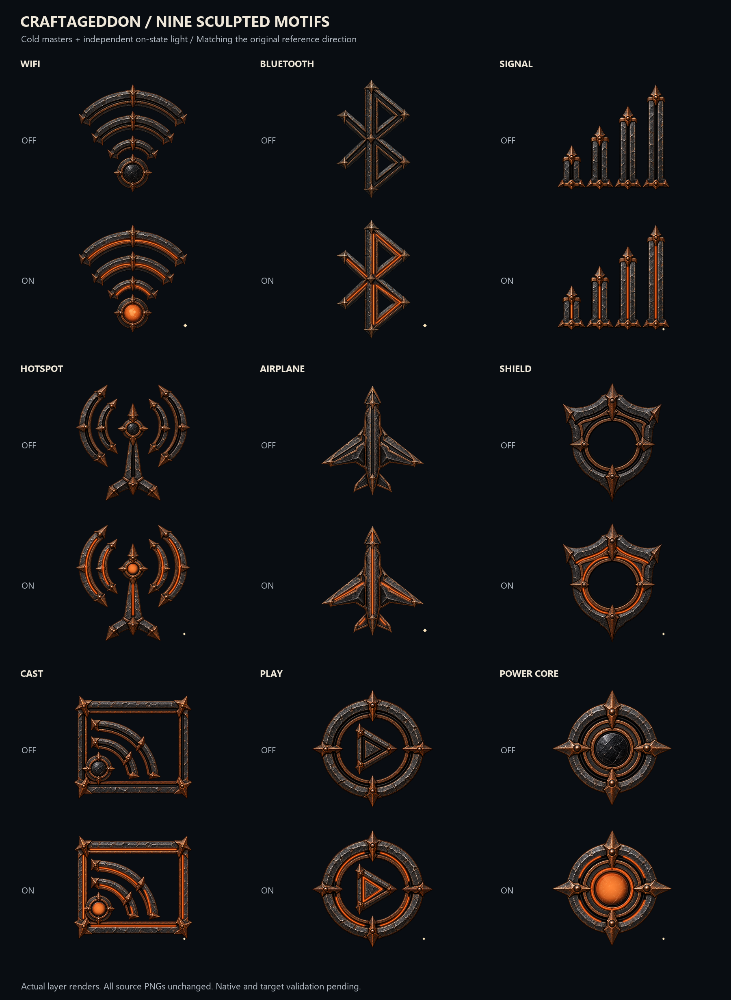
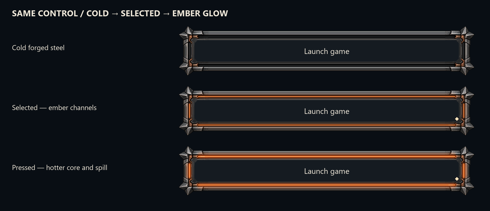
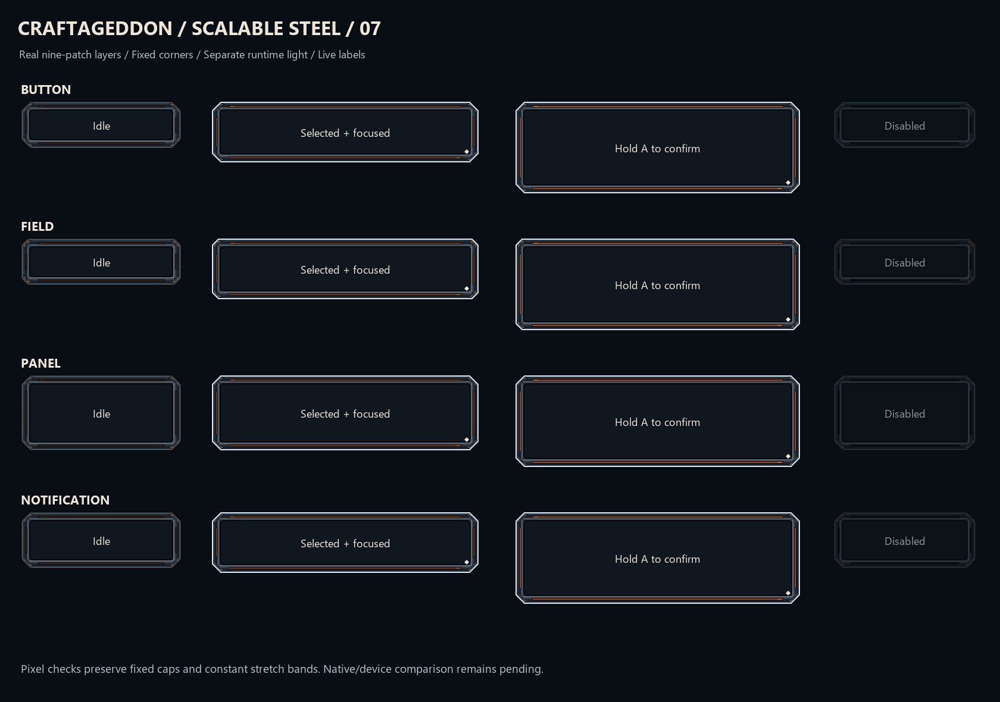

[Latest native contract review](iterations/22-native-contract-review/README.md) —898 source-backed preservation decisions, corrected native resource reference scopes, all254 acquired animated-vector variants traced, and actual host parser/SDK37 resource checks.9,655 family decisions and5 unauthored workflow groups remain open. This pass adds no drawings and does not approve dependent artwork or native/device completion.

[AYN owner adaptation checkpoint21](iterations/21-native-workflows/README.md) contains actual seven-phase calibration and RGB presentation source, separate steel/light resources,14 real Kotlin and4 Java compilations and11 source-backed workflow fixtures. [Semantic/reuse checkpoint20](iterations/20-semantic-review/README.md) preserves the larger source corpus and reuse decisions.

# Current Forge visual and native checkpoints

- [All current visual masters and compositions](iterations/17-forge-coverage/README.md): 472 production master files, 189 editable compositions, 36 contact sheets, plus explicit retained-source decisions. [Browse the contact-sheet index](iterations/17-forge-coverage/current-library/index.html) after downloading/cloning.
- [First native implementation](iterations/18-native-runtime/README.md): API37 Android steel controls, native English labels, a real Quick Settings service and read-only controller/display/battery reporting. [Signed APK](iterations/18-native-runtime/package/Craftageddon-Thor-Native-0.1.0.apk).
- [Remaining work and acceptance limits](iterations/18-native-runtime/remaining-work.json): full OS integration and Android/device execution remain pending. These are signed work-in-progress checkpoints; no hardware flashing occurred.

Earlier project documentation follows and remains historical context.

# Craftageddon Android 16 — Ember Steel

An iterative redesign of the Craftageddon Android interface for AYN Thor, based on the earlier dark forged steel and ember artwork.

The repository retains its Android 16 name and earlier checkpoints. The user selected **current official LineageOS 24.0 / AYN odin2thor** for new native integration. [Current goal and evidence](roadmap/ACTIVE_GOAL_2026-10-22.md) distinguish the remaining artwork from native/device completion.

## Iterations

| Checkpoint | Scope | State |
|---|---|---|
| [01 — Material pilot](iterations/01-material-pilot/) | 18 layered component specimens, cold bases, neutral emission masks, seven state previews | Desktop design checkpoint |
| [02 — Light and legibility](iterations/02-light-and-legibility/) | Clearer emission, sharper sheets, state driver and rich cold hero button | Desktop + bounded Inkscape inspection |
| [03 — Thor compositions](iterations/03-thor-compositions/) | Six editable screen compositions, rich charging socket, controller mapping template and native resource handoff | Desktop + resource compile checkpoint |
| [04 — Core component system](iterations/04-core-components/) | 46 control variants; complete retained-file accounting and proposed source/family register | Desktop design and file validation |
| [05 — System symbols](iterations/05-system-symbols/) | 136 named entries in compact/detailed treatments; 136 compiled Android vectors | Desktop design and resource compile checkpoint |
| [06 — Rich material expansion](iterations/06-material-expansion/) | Original notification/tile cold masters, separate masks and two live-content screen concepts | Desktop material checkpoint |
| [07 — Scalable steel frames](iterations/07-scalable-frames/) | Four frame families, 80 real nine-patch density layers and compile/link evidence | Desktop + Android resource checkpoint |
| [08 — Native Material Lab 0.1.0](iterations/08-native-material-lab/) | Standalone signed APK, Java source, live-text/RTL/width/focus controls and clean rebuild evidence | Built and audited; not installed or device-verified |
| [09 — Rich scalable controls](iterations/09-rich-scalable-controls/) | Notification/tile-style cold steel, fixed corners, seven separate light/state layers and selected/glowing previews | Layered export + resource compile/link checkpoint; APK unchanged |
| [10 — Reference Forge](iterations/10-reference-forge/) | Three chipped-steel detailed icons, neutral light masks, cold-off state contract and four retained frame family comparisons | Three desktop passes + source/state checks; native/device validation pending |
| [11 — Forge symbol library](iterations/11-forge-symbol-library/) | All 136 named symbols in two optical treatments and all nine large sculpted motifs | Full authored-symbol coverage; source/resource checks; device validation pending |
| [12 — Forge controls and screens](iterations/12-forge-controls-and-screens/) | All 46 retained controls, 18 pilots, four new scalable families, eight layouts and live-label input examples | Authored-catalog restyle; 112 resource configurations; native/device validation pending |
| [13 — Android flows and Thor panels](iterations/13-forge-android-and-thor-flows/) | 42 new editable screen concepts, 18 layered controls, cold/selected previews and searchable gallery | Desktop art checkpoint; sample capabilities; full state coverage and native/device work pending |
| [14 — System atmosphere](iterations/14-forge-atmosphere/) | Six layered wallpapers, three atmosphere components and 17 boot/charging/recovery/loading scenes | Static artwork checkpoint; motion and broader visual/native completion remain open |
| [15 — Journey states](iterations/15-forge-journey-states/) | 120 additional scenes, 24 journey families and 263 offline sample transitions; 18 unchanged masters reused | Desktop state/artwork checkpoint; motion, canonical/app coverage and native/device work pending |


The material study above is AI-generated reference art. It defines the intended richness of larger artwork; it is not a production atlas and must not be sliced into controls. The editable pilot deliberately simplifies detail for everyday controls. Each later iteration records what improved and what remains unresolved.


The [native handoff](native-handoff/README.md) records rendering ownership, controller capture/release, profile/display behavior and unrun target tests. [STATUS.md](STATUS.md) distinguishes current design work from the full 103-package roadmap.


The [full source register](iterations/04-core-components/source-register/) accounts for 3,423 retained records: 3,422 valid files and one excluded empty file. Its 1,272 proposed family groups require manual review and are not a count of completed redesigns.

## Use the assets

The [latest journey viewer](iterations/15-forge-journey-states/index.html) covers permission denial/revocation, picker failures, unlock fallbacks, keyboard variants and Thor mapping/profile/capture/hardware outcomes. Open the downloaded HTML locally to follow sample transitions. It changes artwork only and invokes no native or hardware actions.

The [new Android and Thor flow gallery](iterations/13-forge-android-and-thor-flows/index.html) adds 42 editable concept scenes and 18 control masters. Its [cold/selected comparison](iterations/13-forge-android-and-thor-flows/previews/cold-and-selected-scenes.png) shows the same steel with emission hidden or enabled. These are visual fixtures; full state coverage and native/device validation remain open.



The newest Reference Forge passes extend the sharper blackened-steel reference across the [full authored symbol catalog](iterations/11-forge-symbol-library/) and [retained controls/screens](iterations/12-forge-controls-and-screens/). **Off/unselected is cold; selected, checked or on lights the separate ember layers.** Focus and hover alone stay cold; explicit off-value artwork is locked unlit. This supersedes archived warm-idle examples. The [new scalable comparison](iterations/12-forge-controls-and-screens/previews/scalable-frame-states.png) shows actual new textured resources. Historical reconciliation, app-specific icons and unauthored roadmap flows remain open.



Iteration 09 matches the heavier tile/notification material and adds neutral reflection/spill masks. Its [four-family comparison sheet](iterations/09-rich-scalable-controls/previews/selected-and-ember-sheet.png) is rendered from the new assets. Material Lab 0.1.0 still uses iteration 07; the richer assets have not been wired into that APK.

The [standalone Material Lab APK](iterations/08-native-material-lab/release/EmberSteel-MaterialLab-0.1.0.apk) is a local preview application with no requested permissions or hardware-control backend. Its [source, offline build instructions and unrun test matrix](iterations/08-native-material-lab/) are preserved. It does not theme SystemUI or modify LineageOS.



The [October 21 progress register](roadmap/Design_Progress_2026-10-21.csv) retains prior work and records the bounded new scalable-resource evidence. Iteration 07 adds a separate neutral `focus` layer and real Android nine-patch metadata; earlier rich textured artwork keeps its fixed aspect ratio.

Open any `masters/*.svg` in Inkscape. The named layers are `cold`, `seam`, `core`, and `symbol`. Seam/core layers are hidden in the master, white in the separate mask exports, and tinted only for state previews. Text in contact sheets is illustrative; production text stays live in Android. Both 1x and 2x PNG layers have real alpha.

Every iteration preserves a full `complete-assets.zip` locally, including its declared source and exports. Iterations 01–10 also track that ZIP directly. The larger 11–15 archives are stored on GitHub as verified byte-for-byte parts in each `distribution/` folder; run its `Restore-Archive.ps1` after downloading the repository to restore the ZIP. Individual editable SVGs and preview sheets remain browsable. Checkpoints 14 onward also supply detached source-artifact signatures with the pinned public identity in the [signing policy](integration/SIGNING_POLICY.md). Extract the ZIP into an empty folder to use the full pack or audit checksums.

```powershell
python -m pip install -r requirements.txt
python tools/build_pilot.py --iteration 1 --out build-work/01-material-pilot
python tools/verify_pilot.py build-work/01-material-pilot
```

Build into a new folder; the builder refuses to overwrite archived iterations. The geometry/export build is portable; contact-sheet font rasterization can differ when Segoe UI is unavailable.

## Scope and integration

The [103-package roadmap](roadmap/REWORK_PLAN.md) covers the whole library and [Thor/LineageOS](roadmap/THOR_AND_LINEAGEOS_PLAN.md). These commits begin its design phases. They do not claim native SystemUI integration, actual gamepad mapping, working hardware controls, or completed ROM work. No device has been modified or flashed. Device verification remains blocked until an exact firmware/hardware baseline and test access exist.

Cold bases must remain free of baked emission. Compact status glyphs use simpler, steady geometry. Selected controls have a geometric cue; focus remains visible alongside selection. Reduced motion is static. Touch targets need native padding to at least 48dp even when the visible glyph is smaller.

## License and provenance

The repository's original [CC0 1.0 license](LICENSE) is retained for original project geometry, tooling and generated study art. Pinned upstream source/XML/reference artwork keeps its original copyright and license; CC0 does not relicense that evidence. Checkpoint22 preserves original headers and the available [upstream license files](iterations/22-native-contract-review/source/licenses-manifest.json). No third-party font binaries, vendor firmware or proprietary mapping tools are included in this repository. See [art direction](art-direction/README.md).
