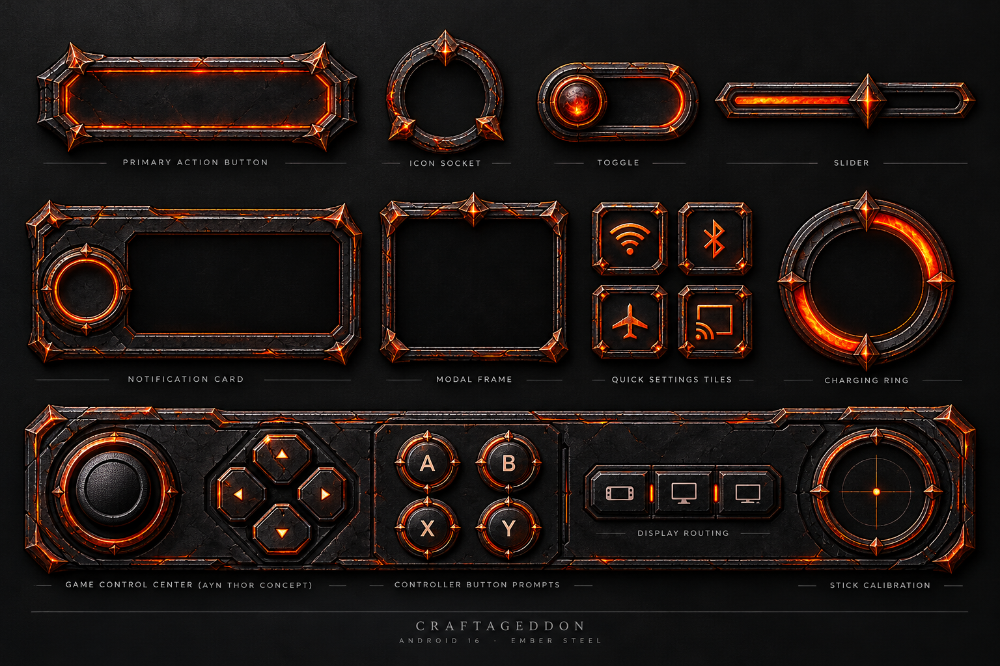
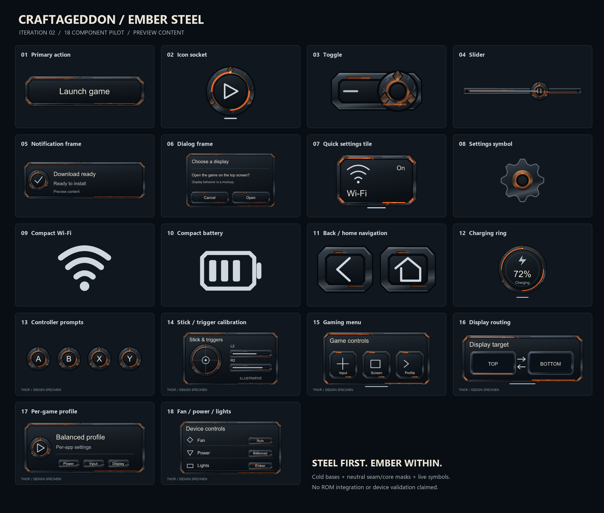
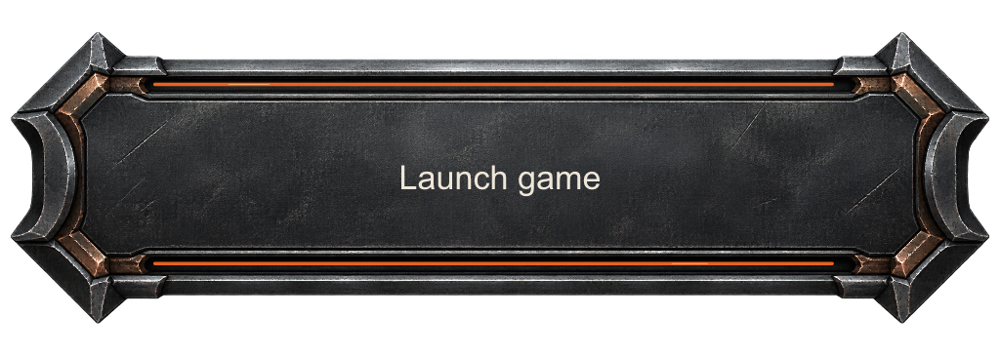
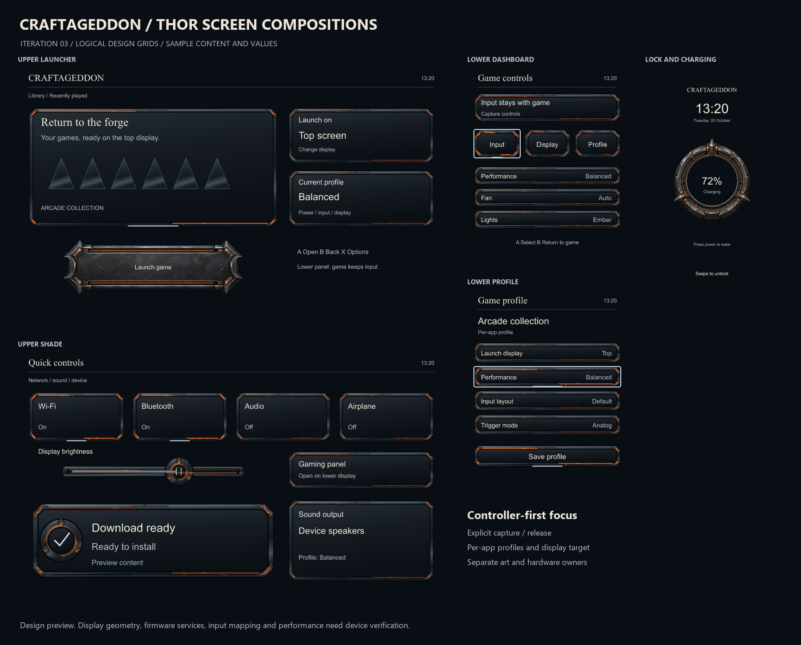
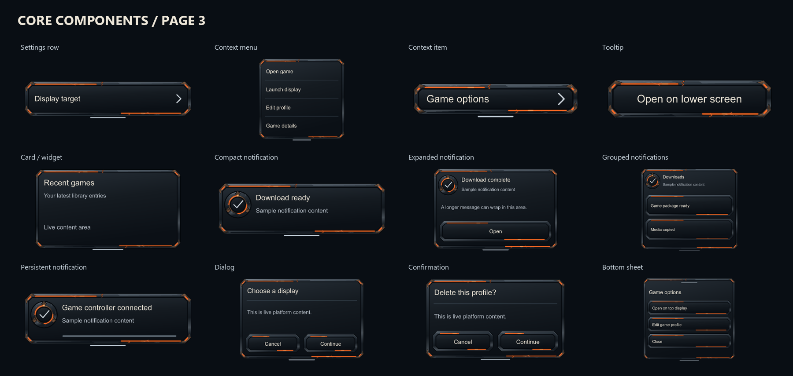

# Craftageddon Android 16 — Ember Steel

An iterative redesign of the Craftageddon Android interface for AYN Thor, based on the earlier dark forged steel and ember artwork.

## Iterations

| Checkpoint | Scope | State |
|---|---|---|
| [01 — Material pilot](iterations/01-material-pilot/) | 18 layered component specimens, cold bases, neutral emission masks, seven state previews | Desktop design checkpoint |
| [02 — Light and legibility](iterations/02-light-and-legibility/) | Clearer emission, sharper sheets, state driver and rich cold hero button | Desktop + bounded Inkscape inspection |
| [03 — Thor compositions](iterations/03-thor-compositions/) | Six editable screen compositions, rich charging socket, controller mapping template and native resource handoff | Desktop + resource compile checkpoint |
| [04 — Core component system](iterations/04-core-components/) | 46 control variants; complete retained-file accounting and proposed source/family register | Desktop design and file validation |
| [05 — System symbols](iterations/05-system-symbols/) | 136 named entries in compact/detailed treatments; 136 compiled Android vectors | Desktop design and resource compile checkpoint |
| [06 — Rich material expansion](iterations/06-material-expansion/) | Original notification/tile cold masters, separate masks and two live-content screen concepts | Desktop material checkpoint |



The material study above is AI-generated reference art. It defines the intended richness of larger artwork; it is not a production atlas and must not be sliced into controls. The editable pilot deliberately simplifies detail for everyday controls. Each later iteration records what improved and what remains unresolved.







The [native handoff](native-handoff/README.md) records rendering ownership, controller capture/release, profile/display behavior and unrun target tests. [STATUS.md](STATUS.md) distinguishes current design work from the full 103-package roadmap.



The [full source register](iterations/04-core-components/source-register/) accounts for 3,423 retained records: 3,422 valid files and one excluded empty file. Its 1,272 proposed family groups require manual review and are not a count of completed redesigns.

## Use the assets

Open any `masters/*.svg` in Inkscape. The named layers are `cold`, `seam`, `core`, and `symbol`. Seam/core layers are hidden in the master, white in the separate mask exports, and tinted only for state previews. Text in contact sheets is illustrative; production text stays live in Android. Both 1x and 2x PNG layers have real alpha.

Every iteration includes `complete-assets.zip` containing its full folder, including the transparent PNG exports. Individual editable SVGs and preview sheets are also browsable in the repository. Extract the archive into an empty folder to use the full pack or run its checksum audit.

```powershell
python -m pip install -r requirements.txt
python tools/build_pilot.py --iteration 1 --out build-work/01-material-pilot
python tools/verify_pilot.py build-work/01-material-pilot
```

Build into a new folder; the builder refuses to overwrite archived iterations. The geometry/export build is portable; contact-sheet font rasterization can differ when Segoe UI is unavailable.

## Scope and integration

The [103-package roadmap](roadmap/REWORK_PLAN.md) covers the whole library and [Thor/LineageOS](roadmap/THOR_AND_LINEAGEOS_PLAN.md). These commits begin its design phases. They do not claim native SystemUI integration, actual gamepad mapping, working hardware controls, or completed ROM work. No device has been modified or flashed. Device verification remains blocked until an exact firmware/hardware baseline and test access exist.

Cold bases must remain free of baked emission. Compact status glyphs use simpler, steady geometry. Selected controls have a geometric cue; focus remains visible alongside selection. Reduced motion is static. Touch targets need native padding to at least 48dp even when the visible glyph is smaller.

## License and provenance

The repository's original [CC0 1.0 license](LICENSE) is retained. New geometry, tooling and generated study art are supplied under that repository license. Historical local references inform the design but are not bundled as production assets. No third-party font binaries, application logos, vendor firmware or proprietary mapping tools are included. See [art direction](art-direction/README.md).
