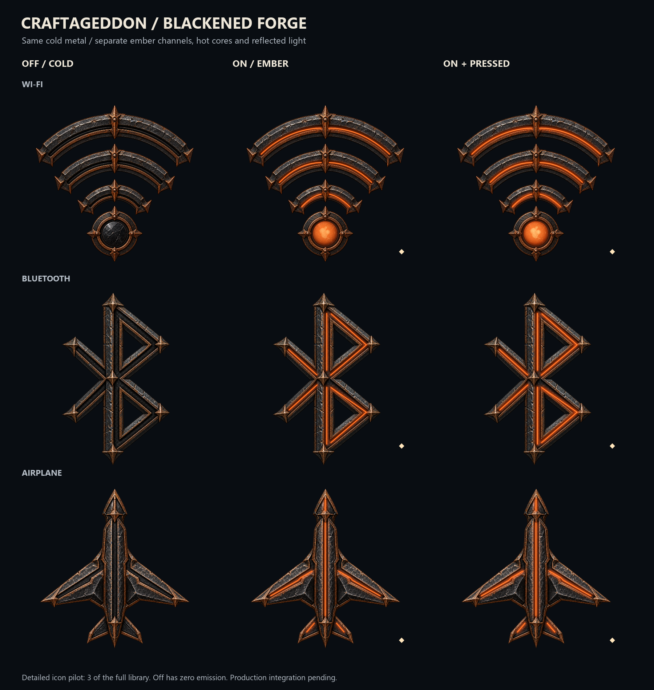
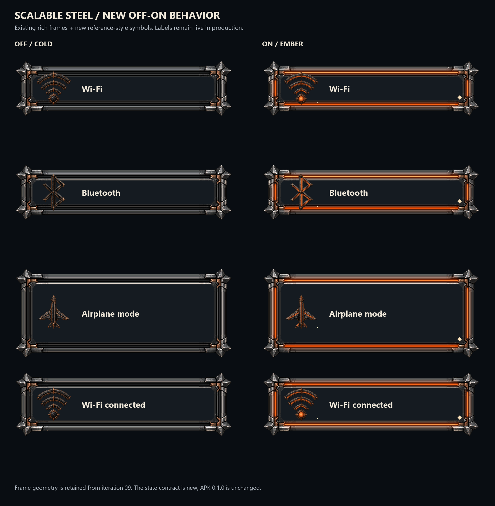

# Reference Forge — iteration 10, 0.10.0 WIP

This pass moves the large artwork closer to the user's new reference: chipped blackened iron, deep carved channels, sharp spear-point fittings and concentrated ember light. It introduces three original cold masters: Wi-Fi, Bluetooth and airplane mode. It does not restyle all 136 symbol entries.



The current rule is **cold when off or unselected; glowing when on, checked or selected**. This supersedes warm-idle examples in archived iterations. Hover, focus, warnings and pressing an off control do not independently ignite it. The owner applies activation first. Active press increases light; reduced motion remains static. Neutral focus brackets and a separate selection diamond provide cues beyond color.

## Files and use

| File | Purpose |
|---|---|
| `masters/*.svg` | Inkscape-compatible assembly; cold visible, six neutral layers hidden |
| `source/*-cold.png` | Unchanged original generated artwork with true alpha; copper is material, not emission |
| `layers/*.svg` | Editable cold / reflection / spill / seam / core / focus / symbol layers |
| `exports/*.png` | 256, 512 and 1024 px transparent layer exports; eight state previews per icon |
| `exports/scalable-frames/android/res` | 112 unchanged iteration 09 nine-patch density configurations, included inside the full archive |
| `runtime-style.json` | Authoritative colors, order and sample gains for this pass |
| `source/state_driver_v2.cjs` | Cold-off state reference for an implementation owner |
| `scalable-frame-binding.json` | Reuse of four previous rich frame families with the new state contract |
| `source/GENERATION.json` | Built-in image generation prompts and exact source hashes |

Extract `complete-assets.zip` into a new directory. Keep `masters`, `layers` and `source` together so the SVG links work in Inkscape. White masks are tinted and composited above the same cold base. Glow is absent from the base. Do not stretch these detailed icon rasters non-uniformly; use them at 96dp and above. Retain simpler compact status glyphs until a separate small-size treatment is reviewed. The scalable frames use fixed caps and genuine Android nine-patch bands.

The full archive includes every PNG export and the retained nine-patch resources. Normal layer PNGs are omitted from individual Git tracking to avoid duplicate storage, but are retained in the ZIP and local working folder.



## Rebuild and validation

From the repository root, install the pinned requirements and run:

```powershell
python tools/build_reference_forge.py --sources iterations/10-reference-forge/source --provenance iterations/10-reference-forge/source/GENERATION.json --out build-work/reference-forge-rebuild --node node
python tools/verify_reference_forge.py build-work/reference-forge-rebuild --node node
node --test tools/state_driver_v2.test.cjs
```

The builder refuses to overwrite an existing output directory. Rebuilding uses the saved cold PNGs; image generation is not required. The repository's iteration 09 resources are the fixed frame input. Contact-sheet typography may vary across platforms.

V1 is a bounded desktop design checkpoint. V2 checks 450 conditions plus six behavior tests: source hashes, exact off/cold pixel equality, neutral masks, recomposition parity, SVG/PNG decoding, channel alignment against material alpha, and all 112 retained nine-patches. V3 target rendering, native blending, accessibility and performance remain NOT RUN. Inkscape sources are supplied; no live Inkscape edit/export round trip is claimed.

Material Lab 0.1.0 and SystemUI are unchanged. Nothing has been installed or flashed. This is a saved source checkpoint, not a final Android release. Restore earlier behavior by selecting an archived iteration; do not replace its files.

## Next work

Continue this material style across signal bars, hotspot, privacy/shield, cast, media play and the other core/socket designs from the reference, then the remaining component library. Develop a distinct compact optical version, review all masks at practical sizes, and wire the approved cold-off state owner into a new standalone preview build before device comparison. Thor hardware integration and LineageOS work remain separate roadmap scope.

The user's reference pixels are not redistributed. The original generated masters, newly authored masks and tooling follow the repository's CC0 license.
