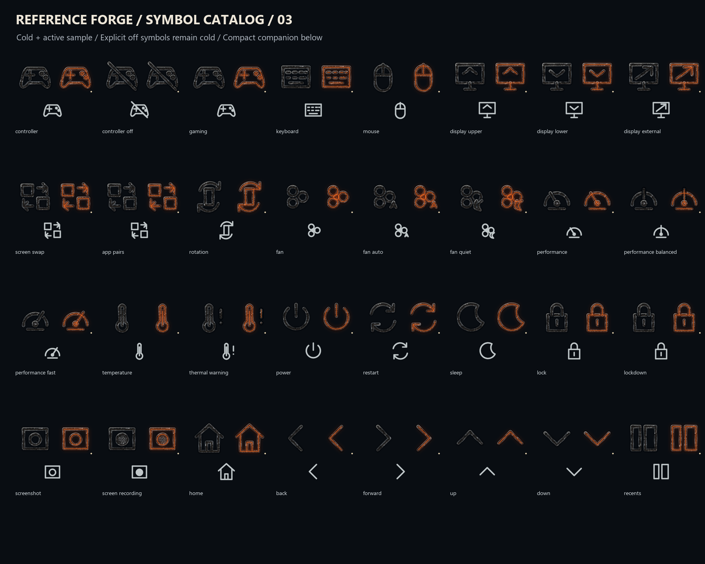

# Reference Forge symbol library — 0.11.0 WIP

The new material direction now covers **all 136 named symbols in the authored catalog**, each in compact and detailed optical treatments, plus all nine sculpted motifs from the reference direction. Six large cold masters and a neutral hammered-steel material were newly generated with the built-in image tool. The first three large masters are retained unchanged from iteration 10.


The detailed catalog uses original editable semantic paths with textured black steel, carved dark channels and restrained copper edges. It is an optical adaptation for everyday icons; it is not a claim that every small icon reproduces the sculptural detail of a large raster master. Compact status glyphs stay simpler and steadier for readability. Several named entries intentionally share geometry because their meaning is distinguished by context.



## Usable files

- `masters/`: 272 layered catalog SVGs plus nine layered sculpted assemblies. The seven layers are cold, reflection, spill, seam, core, focus and symbol. Cold is visible by default. For detailed artwork, symbol is a neutral selection diamond; persistent semantic geometry is in cold.
- `exports/`: 3,934 transparent layer PNGs and 2,248 actual state renders. Compact exports are 24/48px; detailed exports 96/192px; sculpted exports 256/512px. Included inside `complete-assets.zip`.
- `source/`: unchanged original generated PNGs, unchanged earlier masters, generation prompts/hashes and a 256px material render proxy. The proxy is made by SVG resampling, contains no lighting, and is the material actually linked by the vector sources.
- `android/res/drawable/`: 136 cold compact Android vectors. These reproduce flat compact semantic geometry only; rich texture and runtime lighting need a rendering owner.
- `runtime-style.json` and `components.json`: colors, gains, optical use and explicit off-value flags.

Off and unselected assets emit no light. Selected, checked or on enables emission. Hover/focus alone stays cold; neutral focus and selection cues remain separate. `emissionLockedOff` prevents off-value artwork from glowing even when selected. Native owners must pass that flag to the state resolver and choose the correct on/off geometry before lighting. Eight preview states inspect lighting without changing the chosen geometry. Reduced motion is static; no animation timer is implemented.

Extract the complete archive to a new folder and keep `masters` beside `source`; SVG links are relative and work offline. Open SVG masters in Inkscape to edit geometry and masks. No Inkscape edit/export round trip is claimed. Keep sculpted raster assemblies at a fixed aspect ratio and use them at large sizes; they are not stretchable frames.

The full ZIP is preserved locally. GitHub stores that exact ZIP as smaller byte-for-byte parts in `distribution/`; download the repository, then run `distribution/Restore-Archive.ps1` to reconstruct it. The script verifies every part and the final ZIP. `ARCHIVE-PARTS.json` records sizes and hashes. Extract the restored ZIP normally. Transport parts are excluded from the archive itself to avoid recursive packaging.

## Rebuild

From the full repository with pinned requirements installed:

```powershell
python tools/build_forge_symbols.py --out build-work/forge-symbol-rebuild --provenance iterations/11-forge-symbol-library/source/REBUILD.json --node node
python tools/verify_forge_catalog.py build-work/forge-symbol-rebuild --kind symbols --node node
```

`REBUILD.json` names repository-local saved inputs. Image generation is not repeated. The output folder must not exist. Font rendering on contact sheets may vary across platforms.

This is a V1/V2 source checkpoint. Target V3, native blending, accessibility and performance remain pending. The APK, SystemUI and LineageOS are unchanged. The existing historical register's 1,272 proposed families are not a count of restyled/accepted assets; app-specific coverage and unauthored roadmap surfaces remain open. Previous versions are preserved for rollback.
