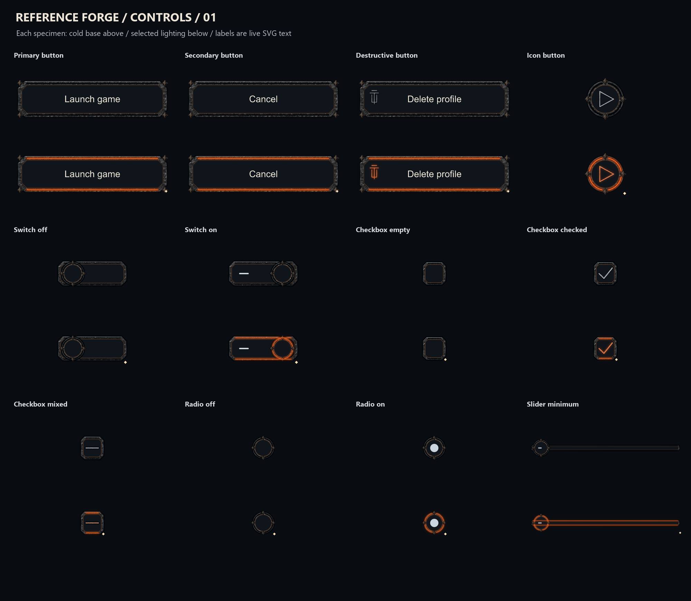
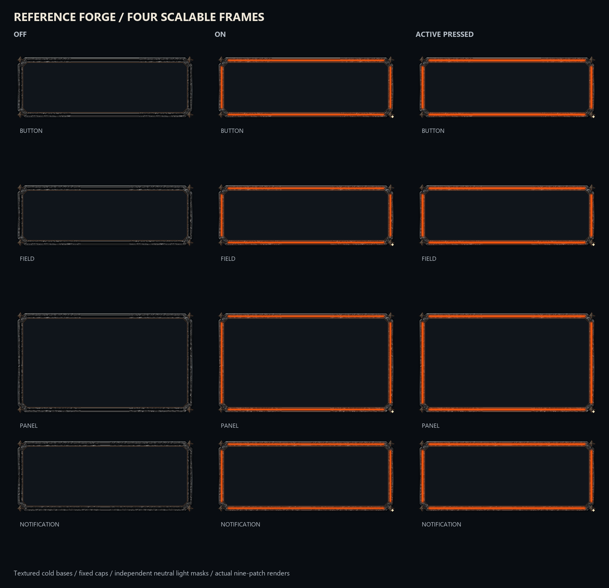
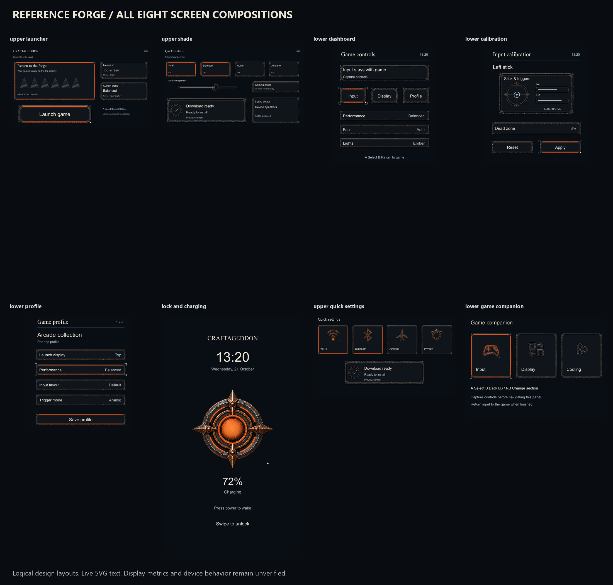

# Reference Forge controls and Thor layouts — 0.12.0 WIP

The Reference Forge material now covers **all 46 retained control variants, all 18 pilot specimens, four new scalable frame families and all eight existing screen compositions**. Controller prompts, shoulder/trigger caps and keyboard keys share the same dark textured steel, restrained copper and separate ember channels as the new symbol catalog.



## Delivered artwork

- 64 layered control/pilot masters; 896 transparent layer exports and 512 state renders.
- Four new textured scalable SVG specimens and 112 Android nine-patch configurations across four densities. The fixed caps retain their pixels; center bands are constant. Only these resource families are stretchable. Other specimens keep their fixed aspect ratio.
- Eight editable Thor/lock/charging screen compositions with live text and explicit selected/off states. These are logical grids, not measured device dimensions.
- Editable controller-prompt and keyboard-layout examples with live labels. Controller labels are logical examples; hardware mapping and IME integration remain unverified.
- Unchanged original generated source images, a cold material proxy, neutral masks, exact gains, source hashes and validation evidence.



Cold, reflection, spill, seam, core, focus and symbol layers remain separate. Symbol is a neutral selection diamond; persistent semantic detail remains in cold. Off/unselected has no emission. On/checked/selected lights the channels; an active press adds intensity. Explicit off-value variants remain cold even under selection. The owner must select geometry first, apply `emissionLockedOff`, then apply gains. Focus is independent neutral geometry. Reduced motion is static and no animation timer is implemented.

Text and values are never baked into the control masters. Text in contact sheets is illustrative; screen/example SVG text stays editable/live. The charging value sits below the hot core so it stays legible. Native text scaling, RTL, touch targets, semantics, controller input and display metrics require target tests.



## Use and rebuild

The complete ZIP contains all source, exports, screens and native resources. Extract it to a new directory and keep `masters`, `screens`, `examples` and `source` together. Individual PNG exports are inside that ZIP and the local work folder. Inkscape can edit the SVG source; no live Inkscape round trip is claimed.

The full ZIP is preserved locally. GitHub stores its exact bytes as smaller parts in `distribution/`. After downloading the repository, run `distribution/Restore-Archive.ps1`; it checks every part and the final ZIP before restoring `complete-assets.zip`. Transport files are excluded from the archive itself.

With the full repository and pinned dependencies:

```powershell
python tools/build_forge_controls.py --out build-work/forge-control-rebuild --symbols iterations/11-forge-symbol-library
python tools/build_forge_examples.py build-work/forge-control-rebuild
python tools/verify_forge_catalog.py build-work/forge-control-rebuild --kind controls --node node
```

Build into an empty directory. The symbol iteration supplies immutable hero artwork and the shared material. The extracted output itself is usable offline without rebuilding. The 48dp minimum hit target must be supplied by native layout even for a smaller visible asset.

This is an authored-catalog source checkpoint. V1/V2 cover desktop review, source/mask/alpha/state parity, the complete retained variant sets, resource compile/link and nine-patch checks. Physical V3, native blend parity, accessibility, memory/frame timing and final visual acceptance remain pending. Material Lab 0.1.0, SystemUI, hardware services and LineageOS are unchanged. Nothing was installed or flashed. Earlier iterations remain available for rollback.

`coverage-map.json` distinguishes restyled authored assets from the unreconciled historical register and unauthored roadmap work. Installed-app icons, new platform flows, wallpaper/boot/motion/sound coverage and ROM integration are not completed by this material pass.
