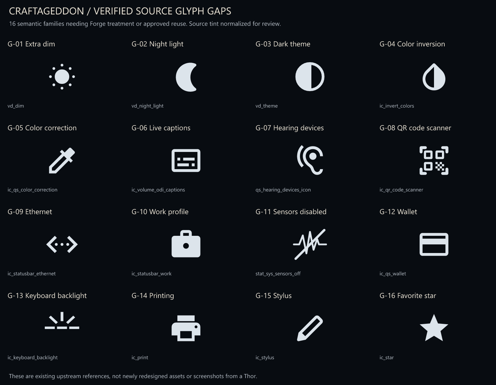

# Source-backed visual gap audit - 26 October 2026

This audit compares the current 472-master Forge catalog with public sources pinned by the official 2026-10-19 LineageOS 24.0 AYN odin2thor build manifest. It found **16 semantic symbol-coverage gaps**, **20 additional app/component binding targets**, and **7 groups of exact-source layout/output adaptation**. These categories overlap and are not a total count of new drawings.

The audit inventories 31 source projects, including 5 complete named framework sections, 16,559 candidate visual/UI resource files and 10,926 qualified source resource families. It downloaded 554 selected source files and verified every one against its Git blob hash and a saved SHA256. The remaining inventory is tree metadata, not a claim that every source image byte was downloaded or visually reviewed.

## Confirmed dedicated symbol gaps

Each source below is an actual parsed vector. None has a dedicated semantic entry in the current authored catalog. Existing generic donors remain available; a donor is not an approved replacement. The preview sheet renders upstream shapes with a neutral tint for comparison. These are dedicated semantic coverage gaps. Suitable existing geometry may be approved for reuse; this is not a count of 16 necessarily new drawings. Feature availability on Thor remains unverified.

| ID | Missing dedicated family | Exact source |
|---|---|---|
| G-01 | Extra dim | [vd_dim.xml](https://raw.githubusercontent.com/LineageOS/android_frameworks_base/7f6de40b6429462d47ba9ba351b99943269c8067/packages/SystemUI/res/drawable/vd_dim.xml) |
| G-02 | Night light | [vd_night_light.xml](https://raw.githubusercontent.com/LineageOS/android_frameworks_base/7f6de40b6429462d47ba9ba351b99943269c8067/packages/SystemUI/res/drawable/vd_night_light.xml) |
| G-03 | Dark theme | [vd_theme.xml](https://raw.githubusercontent.com/LineageOS/android_frameworks_base/7f6de40b6429462d47ba9ba351b99943269c8067/packages/SystemUI/res/drawable/vd_theme.xml) |
| G-04 | Color inversion | [ic_invert_colors.xml](https://raw.githubusercontent.com/LineageOS/android_frameworks_base/7f6de40b6429462d47ba9ba351b99943269c8067/packages/SystemUI/res/drawable/ic_invert_colors.xml) |
| G-05 | Color correction | [ic_qs_color_correction.xml](https://raw.githubusercontent.com/LineageOS/android_frameworks_base/7f6de40b6429462d47ba9ba351b99943269c8067/packages/SystemUI/res/drawable/ic_qs_color_correction.xml) |
| G-06 | Live captions - enabled and disabled | [ic_volume_odi_captions.xml](https://raw.githubusercontent.com/LineageOS/android_frameworks_base/7f6de40b6429462d47ba9ba351b99943269c8067/packages/SystemUI/res/drawable/ic_volume_odi_captions.xml) |
| G-07 | Hearing devices | [qs_hearing_devices_icon.xml](https://raw.githubusercontent.com/LineageOS/android_frameworks_base/7f6de40b6429462d47ba9ba351b99943269c8067/packages/SystemUI/res/drawable/qs_hearing_devices_icon.xml) |
| G-08 | QR code scanner | [ic_qr_code_scanner.xml](https://raw.githubusercontent.com/LineageOS/android_frameworks_base/7f6de40b6429462d47ba9ba351b99943269c8067/packages/SystemUI/res/drawable/ic_qr_code_scanner.xml) |
| G-09 | Ethernet | [ic_statusbar_ethernet.xml](https://raw.githubusercontent.com/LineageOS/android_frameworks_base/7f6de40b6429462d47ba9ba351b99943269c8067/packages/SystemUI/res/drawable/ic_statusbar_ethernet.xml) |
| G-10 | Work profile - enabled and paused | [ic_statusbar_work.xml](https://raw.githubusercontent.com/LineageOS/android_frameworks_base/7f6de40b6429462d47ba9ba351b99943269c8067/packages/SystemUI/res/drawable/ic_statusbar_work.xml) |
| G-11 | Sensors disabled | [stat_sys_sensors_off.xml](https://raw.githubusercontent.com/LineageOS/android_frameworks_base/7f6de40b6429462d47ba9ba351b99943269c8067/packages/SystemUI/res/drawable/stat_sys_sensors_off.xml) |
| G-12 | Wallet | [ic_qs_wallet.xml](https://raw.githubusercontent.com/LineageOS/android_frameworks_base/7f6de40b6429462d47ba9ba351b99943269c8067/packages/SystemUI/res/drawable/ic_qs_wallet.xml) |
| G-13 | Keyboard backlight | [ic_keyboard_backlight.xml](https://raw.githubusercontent.com/LineageOS/android_frameworks_base/7f6de40b6429462d47ba9ba351b99943269c8067/packages/SystemUI/res/drawable/ic_keyboard_backlight.xml) |
| G-14 | Printing | [ic_print.xml](https://raw.githubusercontent.com/LineageOS/android_frameworks_base/7f6de40b6429462d47ba9ba351b99943269c8067/core/res/res/drawable/ic_print.xml) |
| G-15 | Stylus | [ic_stylus.xml](https://raw.githubusercontent.com/LineageOS/android_packages_apps_Settings/b9b9d68135714d9a84741620e9386e1d43931139/res/drawable/ic_stylus.xml) |
| G-16 | Favorite star - filled and outline | [ic_star.xml](https://raw.githubusercontent.com/LineageOS/android_packages_apps_Glimpse/89b473594ec8ad01417624e670912450ce5df7e9/app/src/main/res/drawable/ic_star.xml) |

## App and component target register

The following 20 platform manifest owners are absent from the exact current app target register. Reuse an existing icon/housing where appropriate; do not assume 20 entirely new logos are necessary. **7 source manifests declare a launcher category**; the others have HOME/component roles or require merged-manifest review. Actual visibility, enablement and installed packages are not verified. Do not assign launcher icons to hidden components automatically.

| Module | Source manifest package | Target role |
|---|---|---|
| [AynParts](https://raw.githubusercontent.com/LineageOS/android_hardware_ayn/374ddeee6272222e8b94290e5bef2e9f74f230ef/packages/AynParts/AndroidManifest.xml) | org.lineageos.settings.ayn | HOME/component/merge review |
| [Launcher3QuickStep](https://raw.githubusercontent.com/LineageOS/android_packages_apps_Launcher3/5f26fe66475643ec08fe71a4021946aa57307192/quickstep/AndroidManifest.xml) | com.android.launcher3 | HOME/component/merge review |
| [LineageParts](https://raw.githubusercontent.com/LineageOS/android_packages_apps_LineageParts/fdcb4ba35d92eefbdcca96580fb9e8ac8901ed60/AndroidManifest.xml) | org.lineageos.lineageparts | HOME/component/merge review |
| [LineageSetupWizard](https://raw.githubusercontent.com/LineageOS/android_packages_apps_SetupWizard/69174527a30bc72a28a5d55acdec8ce5edaba9e0/app/src/main/AndroidManifest.xml) | org.lineageos.setupwizard | HOME/component/merge review |
| [Updater](https://raw.githubusercontent.com/LineageOS/android_packages_apps_Updater/6d50e0bf1b16fe7bca818375a3e734f4959e2e57/app/src/main/AndroidManifest.xml) | org.lineageos.updater | HOME/component/merge review |
| [LatinIME](https://raw.githubusercontent.com/LineageOS/android_packages_inputmethods_LatinIME/e417ba6faa5dbb66ba70a038a52ddc8f60bb5795/java/AndroidManifest.xml) | com.android.inputmethod.latin | Launcher declaration |
| [Jelly](https://raw.githubusercontent.com/LineageOS/android_packages_apps_Jelly/64a74fbbc667b19d789c955677bf68f9b8b3eb7e/app/src/main/AndroidManifest.xml) | org.lineageos.jelly | Launcher declaration |
| [ExactCalculator](https://raw.githubusercontent.com/LineageOS/android_packages_apps_ExactCalculator/933974f9fd722e5c79ee0343a251ad5444ac8a23/AndroidManifest.xml) | com.android.calculator2 | Launcher declaration |
| [Etar](https://raw.githubusercontent.com/LineageOS/android_packages_apps_Etar/8173ec802ed046d1670ec03962e686e393a85335/app/src/main/AndroidManifest.xml) | org.lineageos.etar | Launcher declaration |
| [Recorder](https://raw.githubusercontent.com/LineageOS/android_packages_apps_Recorder/624957ca18496e7b63df3d5e4e040f8c99ca72b7/app/src/main/AndroidManifest.xml) | org.lineageos.recorder | Launcher declaration |
| [Twelve](https://raw.githubusercontent.com/LineageOS/android_packages_apps_Twelve/fb82f3c55451b128e1e29c611e582cb7699f7e24/app/src/main/AndroidManifest.xml) | org.lineageos.twelve | Launcher declaration |
| [Seedvault](https://raw.githubusercontent.com/LineageOS/android_packages_apps_Seedvault/f47750d208dc69bdd65744e49ceb287b43aa5c00/app/src/main/AndroidManifest.xml) | com.stevesoltys.seedvault | HOME/component/merge review |
| [AudioFX](https://raw.githubusercontent.com/LineageOS/android_packages_apps_AudioFX/2fc3a5405fb9d7330ad787e106af8229c7a72830/AndroidManifest.xml) | org.lineageos.audiofx | Launcher declaration |
| [Camelot](https://raw.githubusercontent.com/LineageOS/android_packages_apps_Camelot/cdaa5702eea5c725599b650bede715550dbd8a4c/app/src/main/AndroidManifest.xml) | org.lineageos.camelot | HOME/component/merge review |
| [Profiles](https://raw.githubusercontent.com/LineageOS/android_packages_apps_Profiles/0abb3a177f1532b6b85621a7250a6431027f02a6/AndroidManifest.xml) | org.lineageos.profiles | HOME/component/merge review |
| [Backgrounds](https://raw.githubusercontent.com/LineageOS/android_packages_apps_Backgrounds/b087d2df6601aa25939e654028321bb59857d12e/AndroidManifest.xml) | org.lineageos.backgrounds | HOME/component/merge review |
| [Canvas](https://raw.githubusercontent.com/LineageOS/android_packages_apps_Canvas/52265a4619e4b0f867903a5c117ec6c01aefc686/app/src/main/AndroidManifest.xml) | org.lineageos.canvas | HOME/component/merge review |
| [ThemePicker](https://raw.githubusercontent.com/LineageOS/android_packages_apps_ThemePicker/32f081ec5dac9ec86fb0c0bbc372e91176708660/AndroidManifest.xml) | com.google.android.apps.wallpaper | HOME/component/merge review |
| [AvatarPicker](https://android.googlesource.com/platform/packages/apps/AvatarPicker/+/55ea46b9c63f0b9ab96a0b3550d5ca8a97520487/AndroidManifest.xml?format=TEXT) | com.android.avatarpicker | HOME/component/merge review |
| [QuickAccessWallet](https://android.googlesource.com/platform/packages/apps/QuickAccessWallet/+/328a2433f9619ec63b1921e874ec34d86be74e24/AndroidManifest.xml?format=TEXT) | com.android.systemui.plugin.globalactions.wallet | HOME/component/merge review |

These are source manifest packages for the platform build. Gradle development variants can differ: Etar, for example, declares org.lineageos.etar in its platform manifest while its Gradle applicationId is ws.xsoh.etar. The audit preserves both source files and does not substitute the development package.

Thor product evidence: the pinned product inherits vendor/lineage/config/common_full_tablet_wifionly.mk; common_mobile and common_mobile_full name many of these apps. The device common source explicitly sets PRODUCT_NO_CAMERA := true, which makes the conditional Aperture entry inappropriate to mark as an unconditional Thor app target. Product-package-declarations.json preserves literal declarations and conditions; Make was not evaluated. Proprietary/vendor, partner/GMS and user-installed packages are outside the resolved inventory.

## Existing designs that need exact-source adaptation

These groups can reuse steel/control artwork; they are not all missing base assets.

| ID | Owner-specific work | Required adaptation |
|---|---|---|
| W-01 | [AYN seven-phase calibration and live test UI](https://raw.githubusercontent.com/LineageOS/android_hardware_ayn/374ddeee6272222e8b94290e5bef2e9f74f230ef/packages/AynParts/src/org/lineageos/settings/ayn/joystick/CalibrationUiState.kt) | Adapt Intro, Center, RangeLeft, RangeRight, DeadzoneLeft, DeadzoneRight and Test to the real Compose owners. Current generic calibration concepts are donors, not an exact state/owner binding. Preserve live crosshair/dot travel, readiness and actual input values. |
| W-02 | [AYN RGB channel dialog and preferences](https://raw.githubusercontent.com/LineageOS/android_hardware_ayn/374ddeee6272222e8b94290e5bef2e9f74f230ef/packages/AynParts/res/layout/dialog_rgb_sliders.xml) | Adapt actual red/green/blue sliders and preference state. Keep channel semantics and numeric values live; separate the steel/ember shell from selected RGB color content. |
| W-03 | [First-run setup, restore and navigation/theme guidance](https://raw.githubusercontent.com/LineageOS/android_packages_apps_SetupWizard/69174527a30bc72a28a5d55acdec8ce5edaba9e0/app/src/main/java/org/lineageos/setupwizard/WelcomeActivity.kt) | Create owner-matched welcome/restore/navigation/theme compositions and replace or adapt branded guidance illustrations/motion. Existing generic permission/keyboard/boot scenes do not establish these actual setup flows. |
| W-04 | [Updater download, progress and error presentation](https://raw.githubusercontent.com/LineageOS/android_packages_apps_Updater/6d50e0bf1b16fe7bca818375a3e734f4959e2e57/app/src/main/java/org/lineageos/updater/UpdatesActivity.java) | Adapt actual update-card/scaffold/progress/error states and existing upstream update illustrations. Recovery concepts alone are not the Updater application interface. This audit performs no update or install. |
| W-05 | [Gallery albums, viewer and media details](https://raw.githubusercontent.com/LineageOS/android_packages_apps_Glimpse/89b473594ec8ad01417624e670912450ce5df7e9/app/src/main/res/layout/activity_view.xml) | Map album/viewer/detail layouts, favorites and media states; preserve live image content. Existing photo-picker and media-cell concepts provide donors. Favorite star is separately listed as a confirmed glyph gap. |
| W-06 | [Magnification controls and window border](https://raw.githubusercontent.com/LineageOS/android_frameworks_base/7f6de40b6429462d47ba9ba351b99943269c8067/packages/SystemUI/res/layout/fullscreen_magnification_border.xml) | Adapt magnifier/window handles and controller layout with proper focus/contrast. Existing search/focus geometry is a donor rather than an approved magnification resource binding. |
| W-07 | [Native boot/charger/recovery asset contracts](https://raw.githubusercontent.com/LineageOS/android_vendor_lineage/87daf527b0288b60c9cc07c05a5f5aad1660c234/bootanimation/Android.bp) | Existing static scenes and desktop motion require Android boot-animation/charger/recovery-specific output and live owner integration. Confirm dimensions, ordering, timing and color modes from the actual resource contracts before producing packages. |

## Unresolved source coverage

The audit deliberately retains unassigned source families. An unmatched Android filename is not proof a new drawing is needed: it may be an alias, selector, obsolete skin, build-flag variant, dependency or unreachable resource. The qualified family key preserves source roots and density/state variants rather than collapsing unrelated modules.

| Source-family disposition | Count |
|---|---|
| Unassigned visual source family; requires semantic review; NOT counted as confirmed missing artwork | 7048 |
| Name-based reuse candidate; exact geometry/state/owner binding NOT verified | 210 |
| Native layout/token adaptation; new illustration requirement unreviewed | 3164 |
| Test/sample source; excluded from production gap count | 125 |
| Native state/motion adaptation; no automatic new drawing claim | 363 |
| Reviewed semantic artwork gap | 16 |

**7,048 source families remain unassigned for semantic review.** 210 name-based reuse candidates are not validated bindings. 3,164 layout/token groups and 363 motion groups need native owner review. 125 test/demo families are excluded. The 16 reviewed glyph gaps are a confirmed set, not an exhaustive upper bound on missing artwork.

The 31 source projects are complete Git tree inventories except frameworks/base, where the audit includes the entire core/res, packages/SystemUI, packages/SettingsLib, libs/WindowManager/Shell and cmds/bootanimation sections. The initial globally truncated framework response was rejected. All included sections are untruncated.

## Next work order

1. Complete G-01 through G-16 by designing a dedicated treatment or explicitly approving suitable existing geometry, masks and semantic labels; preserve English labels as live resources. Prioritize Android/Thor-supported features when actual availability is established.
2. Bind the source-listed app/components deliberately; start with launcher-facing calculator, browser, calendar, recorder, music and audio tools. Reuse valid existing donors.
3. Adapt the actual AynParts calibration/RGB owners, then setup/updater/gallery layouts and native output contracts.
4. Review unassigned source families using owner reachability, aliases and compiled resources; do not generate thousands of speculative icons from filenames.
5. Run Android/device visual acceptance separately. No device was requested or modified in this audit.

## Evidence and limits

- source-projects.json and source-trees/: exact revisions, full tree evidence and framework section scope.
- resource-files.csv and resource-family-dispositions.csv: complete inventory for the declared scope. Compressed JSON equivalents support repository-only reuse; full raw CSV/JSON is in the signed checkpoint ZIP.
- confirmed-glyph-gaps.json, additional-app-targets.json and workflow-adaptations.json: source hashes, exact owners and proposed existing donors.
- source-evidence.json and source-evidence/: hash-checked source bytes, XML and selected source-drawn UI.
- product-package-declarations.json: source declarations and conditions, not a final installed list.

This is a source audit. It does not establish the complete built-ROM resource table, resource-overlay precedence, compiled package identities or real-device coverage. No artwork, APK, OS source, hardware setting or firmware was altered. Existing visual and native checkpoints remain unchanged. Upstream source notices are retained; reference source is not reclassified as original CC0 artwork.
