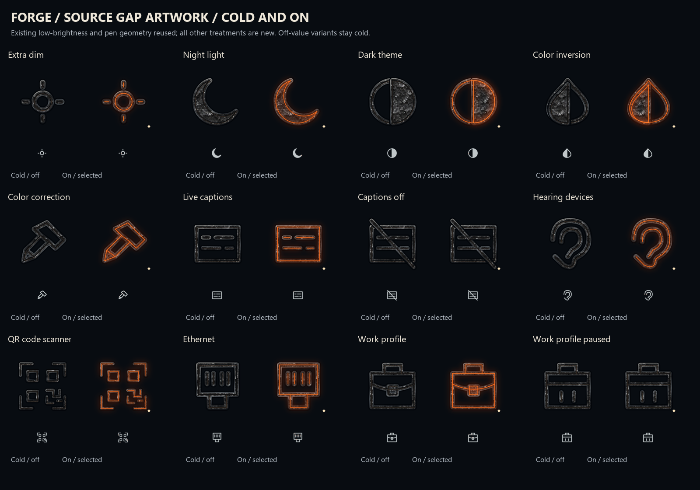
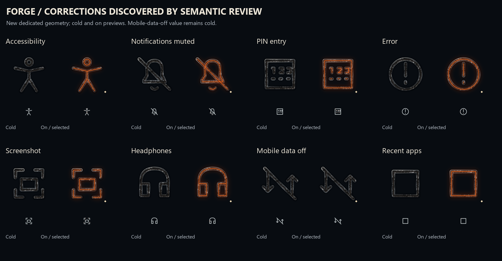
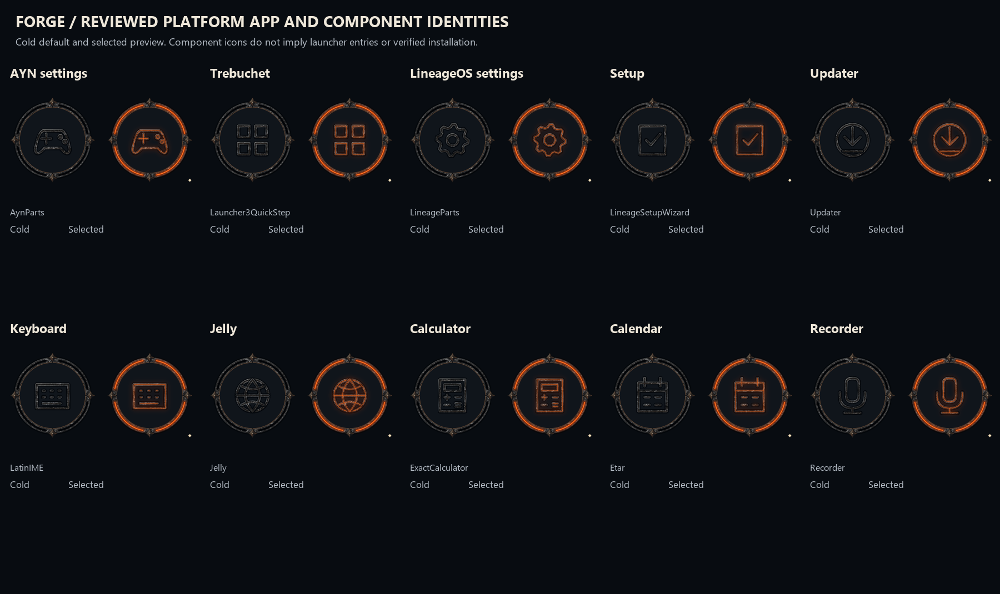

# Forge 20 - source-backed semantic review and artwork

This is a saved work-in-progress iteration. The whole review goal remains active. The pinned target is official LineageOS 24.0 / Android 17 / AYN odin2thor, using the previously verified 2026-10-19 build-source manifest. This is a reproducible source baseline, not a claim about today's newest release or the device's installed applications.

The checkpoint acquires and hash-verifies all **16,559 source resource variants / 15,915 distinct objects**, covering the same **10,926 families** as iteration19. Every source byte is retained. Supporting native owner/default-English/value/notice files and the earlier554 source-context files are preserved too. XML, bitmap, animation, archive, empty-slot and test-fixture evidence is explicit; parsing does not approve artwork reuse.

The new artwork comprises **70 editable masters**:38 masters for the16 named gap families and their state variants,16 additional correction masters for8 glyphs discovered during review, and16 application/component identities. Four of the38 gap masters are unchanged low-brightness/pen aliases; the other66 masters are newly authored treatments. There are **980 separate production layer exports** and560 recomposed state previews. The canonical cold steel, reflection, spill, seam, core, focus and symbol layers remain separate. All authored labels use native English resources. Selected previews are illustrations of runtime composition, not production rasters with baked ember.

The210 tentative reuse candidates now have explicit decisions, alongside4 additional structural false matches. Actual source-to-donor cards reveal why a numeric PIN pad is different from a pushpin, a crossed notification bell from a speaker, and an error alert from a cancel X. The review approves189 semantic artwork uses, replaces16 proposed donors with8 new dedicated glyphs, retargets one X to the existing close artwork, and rejects8 whole-resource icon swaps that would discard native structure. These are artwork decisions; **zero native drop-in substitutions are approved**. Exact source/donor hashes, state conditions and native-owner requirements are retained in `reuse-decisions.json` (compressed Git copy available).112 unchanged donor masters and their required steel material are copied into `approved-reuse/` for a portable handoff.

All20 app/component targets have manifest-role decisions. Sixteen declare an application icon and receive a Forge identity. Profiles, Backgrounds, AvatarPicker and QuickAccessWallet declare no application icon in the reviewed manifests and gain no invented launcher entry. Camelot is a PDF viewer; Canvas is an image editor. Platform package identities remain separate from development package variants, merged-manifest results and installed presence.

The source owner shows that Sensors Off is an **active privacy mode**. It glows when sensor privacy is enabled and remains cold when that mode is disabled. Physical sensors being blocked does not make the privacy control inactive. Caption-off, paused work, unchecked favorites and mobile-data-off value artwork retain explicit cold rules. Focus alone remains neutral.

## Use and verify

Open `masters/`, `app-masters/`, `review-corrections/masters/` or `approved-reuse/*/masters/` in Inkscape. Source SVGs have no baked text. Native strings, compact vectors and adaptive-icon handoffs are in `android/`, `android-apps/` and `review-corrections/android/`. Compact vectors match the authored cold PNG pixels through an independently parsed XML renderer; the Android resource groups compile with the installed API37 build tools. This is resource compilation, not an Android runtime test.

The full signed `complete-assets.zip` is preserved locally. In Git, the large archive is transported as exact byte parts in `distribution/`. Download/clone the repository and run `distribution/Restore-Archive.ps1`; verify the detached signature against the pinned public key, then extract into an empty folder. The archive includes the complete source object corpus, source context, raw and compressed ledgers, production exports and editable art. Git retains compressed ledgers and browseable artwork instead of thousands of individual upstream objects. Original upstream source is data and is never executed by the review tools.

The scoped verifiers are `tools/verify_semantic_gap_art.py`, `tools/verify_semantic_app_bindings.py` and `tools/verify_semantic_checkpoint.py`. Run the gap verifier again with `--root iterations/20-semantic-review/review-corrections` for the additional glyphs. Reproducing full byte checks requires restoring/extracting the source corpus and retaining the prior repository checkpoints. See [REVIEW.md](REVIEW.md) and [the source notices](THIRD_PARTY_SOURCES.md).

## Still required

**10,554 family decisions remain open**, including the wider formerly unassigned artwork and remaining layout/token/motion review. That count includes categories beyond the original7,048 unassigned families; it is not a count of newly discovered missing drawings. Seven exact-source workflow/output adaptation groups remain: AYN seven-phase calibration/live testing, RGB preferences, SetupWizard, Updater, Gallery/Glimpse, magnification, and native boot/charger/recovery outputs. Native owner bridges, further discovered artwork and a fresh final independent double-check must follow. Device execution was explicitly deferred by the user. No hardware installation, settings change or flashing occurred.

The full requirement register is [the active semantic-review goal](../../roadmap/SEMANTIC_REVIEW_GOAL_2026-10-26.md). This checkpoint closes neither the full source-family review nor the LineageOS roadmap.
