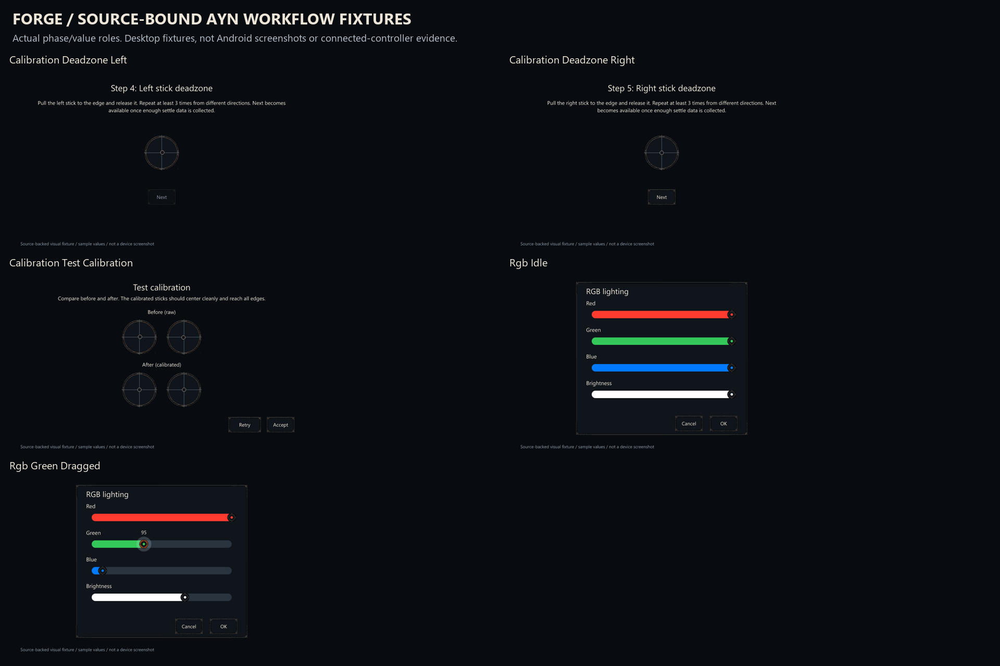

# Forge 21 - actual AynParts calibration and RGB presentation

This work-in-progress checkpoint adapts the **real pinned AynParts owners** rather than treating the earlier generic Thor concepts as completed native workflows. The target remains LineageOS24.0 / Android17 / odin2thor, at hardware/ayn revision `374ddeee6272222e8b94290e5bef2e9f74f230ef` from the official2026-10-19 build manifest.

The source patch covers all seven calibration phases: Intro, Center, RangeLeft, RangeRight, DeadzoneLeft, DeadzoneRight and Test. Raw and calibrated positions stay distinct. Nine original coordinate/clamp expressions, the readiness guard, phase machine, sampling, persistence and all hardware utilities remain intact. The moving position ornament is native data; no center position is baked into its gate. Analog lighting follows actual input amplitude, so near-zero raw noise does not switch the artwork to full brightness. The neutral crosshair and cold position rim remain visible with emission off.

The RGB dialog preserves its four IDs,0–255 ranges, source steps5/5/5/17, actual channel colors and nine live/confirm/cancel helper/callback bodies. English channel labels are live resources. Red/green/blue/white swatches remain **data colors**, independently of ember interaction lighting. Material clones custom thumbs and does not forward custom drawable state like it does for default thumbs; the custom thumb supplies a real ConstantState and reads its actual owning slider through a weak reference. No extra hardware callback is introduced. The exact pinned Material binary's cloning contract is inspected in the evidence, alongside the [upstream implementation](https://github.com/material-components/material-components-android/blob/master/lib/java/com/google/android/material/slider/BaseSlider.java).

Three new textless layered masters provide the120dp stick gate,20dp moving position ornament and36dp RGB thumb. Three compact optical treatments adapt the established button, field and panel frames. Their metadata is rebuilt after resizing the image content: black nine-patch bands are never resampled as artwork. Fixed caps now fit96×56dp buttons,112×56dp outlined fields and112×88dp minimum panels. There are63 new fixed-control layer exports and84 adapted nine-patch configurations, totaling147 native PNG resources. Cold, reflection, spill, seam, core, focus and symbol stay separate; runtime tint supplies ember. Focus alone is neutral.

The source also makes the calibration content scrollable, keeps Test's Accept/Retry actions outside the scrolling comparison, and allows action rows to wrap. Material buttons keep native click, enabled, keyboard and accessibility behavior, with at least56dp height. RGB labels are associated with their real sliders. Native English wording now says Next **becomes available** instead of incorrectly implying that steps advance automatically. UTF-8 is explicit throughout the source transformation.

The11 editable SVG/PNG workflow fixtures cover the seven phases, absent samples, readiness, raw/calibrated data, and idle/dragging RGB. These are **source-backed desktop illustrations**, not Android screenshots or proof of connected hardware. Their960×540 logical viewport and Segoe UI font are visual fixtures, not measurements of either Thor display.

## Source handoff and checks

`native-patch/hardware/ayn/packages/AynParts/` contains the reviewable source/resources. `upstream/` preserves38 exact source/resource receipts. The source patch applies cleanly in an isolated checkout and matches every changed text byte; original CRLF/LF conventions are retained. Copy the corresponding hash-listed PNG resources as well: the text patch deliberately does not encode binary assets.

From a matching source checkout, first inspect `AynParts-forge-source.patch` and `changed-files.json`, then use `git -c core.autocrlf=false apply --check <path-to-patch>` before applying. This is a source handoff, not an installation or flashing script. The original module's platform signing and protected owner requirements remain unchanged.

Bounded validation compiles **4 real Java classes and14 real Kotlin files**, including the actual calibration presentation, patched RGBPreference and unchanged source data/mapping/LightUtils/NodeUtils. No owner or model stubs are generated. Material1.14.0-alpha99, AppCompat1.8.0-alpha01 and Preference1.3.0-alpha01 are fetched and Git-blob/SHA256 verified at the official SDK source pin `0f07e8d60ab0aba46129e427101f96ba459a95c1`. Compose compilation uses the recorded installed Kotlin/Compose2.3.21 toolchain and Material3-Android1.4.0 compatibility classpath. This is not represented as the full pinned Soong dependency resolution.

The normal compile-only resource symbols are derived from real resource declarations. **The JARs and resource banks under verification/evidence are compile evidence, not runtime packages:** their temporary resource IDs must not be installed or copied into the system. Adopt the source/resources and rebuild the actual module to generate its correct IDs. No APK is produced for installation.

The128 activation/focus/disable combinations, all147 native PNG configurations, alpha/neutral masks, fixed-cap metadata, exact state recompositions, source callback/coordinate preservation and source patch parity are checked. Cold crosshair contrast against the well is3.79:1. Prior signed checkpoint20 and historical artwork remain unchanged. See [REVIEW.md](REVIEW.md).

## Remaining work

The full semantic-review goal remains active: **10,553 family decisions** remain open. This checkpoint records one content-backed family decision for the real RGB layout and authors source/artwork adaptations for W-01/W-02. SetupWizard, Updater, Gallery/Glimpse, magnification and boot/charger/recovery source adaptations remain. Wider artwork, native owner bridges for the new symbol/app treatments and the final independent whole-goal double-check are unfinished.

Full pinned AynParts/ROM Soong builds, Android execution, Material dialog lifecycle/state behavior on target, both actual display geometries, controller input, performance and physical acceptance are NOT RUN. The user explicitly deferred device access. The source hardware methods are compiled as unchanged dependencies, never executed by these tests. No hardware setting, installation or flashing occurred.

New Craftageddon work follows the repository license. Modified/upstream AynParts files retain their Apache-2.0 notices and terms; see `source/LICENSE-APACHE-2.0.txt`. SDK blueprint/dependency receipts retain their source provenance. Dependency AARs stay in the ignored local build cache and are not republished as artwork.
